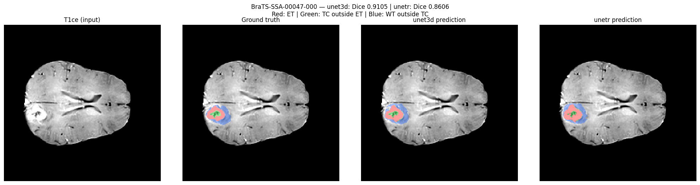
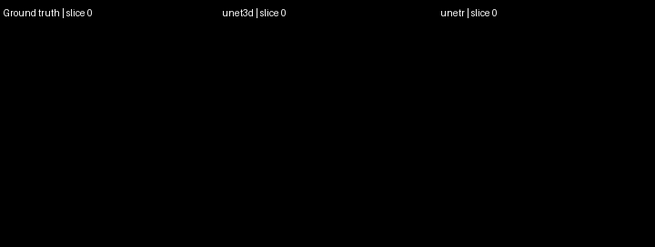
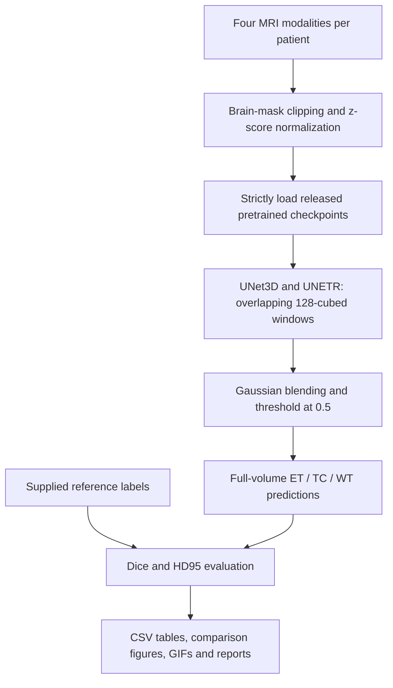

# 3D Brain Tumor Segmentation

**A pretrained inference and evaluation project by Prakhar Gupta ([ZekRock18](https://github.com/ZekRock18)), with project teammate Aditya Dubey.**

This project runs **UNet3D and UNETR on real BraTS-Africa MRI scans**, compares their segmentations with supplied reference labels, and produces an illustrated report. The completed Kaggle run evaluates four patients using both models on a **Tesla T4 GPU**. No training or fine-tuning was performed.

[**Run / view on Kaggle**](https://www.kaggle.com/code/zekrock/brain-tumor-seg-brats-africa) · [**Teacher report**](project_report_teacher.pdf) · [**Technical reference**](project_reference.pdf) · [**Presentation notes**](presentation_notes.pdf) · [**Complete download**](https://github.com/ZekRock18/brain-tumor-segmentation/releases/latest)

## What I built

This repository presents my project delivery: a self-contained Kaggle workflow, BraTS-Africa case discovery and modality mapping, pretrained checkpoint loading, full-volume evaluation, visual comparisons, animated slice sequences, and documented execution verification. The package also includes a detailed technical guide and a teacher-facing report.

The underlying architectures, learned weights, and original preprocessing/metric implementation come from **[MohanadMahran/Brain_Tumor_Benchmark](https://github.com/MohanadMahran/Brain_Tumor_Benchmark)** and the linked Hugging Face model repositories. Those contributions remain credited to their original authors. This project does **not** claim to have designed or trained the released models.

## See the results

Each comparison shows the same axial MRI slice with the reference segmentation and both model predictions. The metrics are calculated over the complete 3D volume, not just this displayed slice.



**Animated slice comparison:** the GIF moves through axial slices of the volume; it is not a 3D surface rendering.



Red indicates enhancing tumor; green shows tumor core outside the enhancing region; blue shows whole tumor outside the core. The three evaluated masks overlap, while the visible overlay colors are drawn in layers.

## Measured results

These are the results of **our completed four-patient Kaggle run (version 6)**, not the original author's validation scores.

| Model | ET Dice ↑ | TC Dice ↑ | WT Dice ↑ | Mean Dice ↑ | Mean HD95, mm ↓ |
|---|---:|---:|---:|---:|---:|
| UNet3D | 0.8611 | 0.7868 | 0.9158 | 0.8546 | 6.3594 |
| UNETR | 0.8618 | 0.8281 | 0.8788 | 0.8562 | 5.6408 |

Means cover the same four patients. The mean columns average the three tumor regions and patients equally. Each model has the higher mean Dice on two patients; the small overall difference does not establish general superiority.

| Patient | Cohort | UNet3D mean Dice | UNETR mean Dice |
|---|---|---:|---:|
| BraTS-SSA-00047-000 | Glioma | 0.9105 | 0.8606 |
| BraTS-SSA-00068-000 | Glioma | 0.7635 | 0.7797 |
| BraTS-SSA-00111-000 | Other neoplasms | 0.8831 | 0.8465 |
| BraTS-SSA-00170-000 | Other neoplasms | 0.8611 | 0.9381 |

[Full-precision per-region CSV](results/brats_africa_results.csv) · [Run settings and checkpoint hashes](results/run_metadata.json) · [Executed notebook](results/executed.ipynb)

## How it works



- **Inputs:** T1, contrast-enhanced T1, T2 and FLAIR, plus a reference segmentation for evaluation.
- **Selection:** seed 42; the four evaluated IDs are recorded in `results/selected_cases.csv`.
- **Inference:** 128 × 128 × 128 windows, 25% overlap, Gaussian blending, sigmoid threshold 0.5 and CUDA mixed precision.
- **Checkpoint sizes:** 19,992,603 parameters for UNet3D; 19,327,907 for UNETR. Strict loading and exact SHA-256 identities were checked.
- **Execution evidence:** all 15 code cells executed, no saved notebook execution errors, eight model-case evaluations and 19 expected report artifacts.

The clean notebook includes project attribution added for this GitHub publication. The executed notebook is preserved as the historical version 6 artifact; its outputs have not been rewritten to imply another run.

## Run it on Kaggle

1. Open the [public notebook](https://www.kaggle.com/code/zekrock/brain-tumor-seg-brats-africa), or import [`notebooks/brain-tumor-seg-brats-africa.ipynb`](notebooks/brain-tumor-seg-brats-africa.ipynb).
2. Attach [`yakunokamizen/brats-africa`](https://www.kaggle.com/datasets/yakunokamizen/brats-africa) and the checkpoint input. The original input is [`zekrock/brats-weights`](https://www.kaggle.com/datasets/zekrock/brats-weights); its access may depend on the account.
3. If necessary, create your own private checkpoint input from the two binaries in the complete release, preserving the filenames. Original checkpoints are also available from the credited Hugging Face repositories below.
4. Select a GPU session and verify that the setup cell reports CUDA. Complete account verification if Kaggle requests it. The notebook deliberately stops if a GPU was requested but unavailable.
5. Run every cell in order. Confirm `END-TO-END COMPLETE` and the artifacts listed in `SUCCESS.json`, then save the executed version.

This workflow uses the selected CUDA device; it does not distribute inference across two GPUs. It requires no local MRI download. Account availability, dependencies and dataset access can affect a future rerun.

## Offline presentation and complete package

Download **`FINAL_PROJECT.zip` from [Releases](https://github.com/ZekRock18/brain-tumor-segmentation/releases/latest)** and extract it. Open `START_HERE.html`, then `results/report.html`. The figures, animations, tables and PDFs can be shown without rerunning the models.

The release includes both checkpoint binaries. They are omitted from Git history to keep the repository manageable. `CONTENTS.csv` and `MANIFEST_SHA256.csv` describe the **complete release package**, including those binaries; a plain Git clone therefore intentionally lacks those two files. Raw MRI data and credentials are not included in either distribution.

| Location | Contents |
|---|---|
| `project_report_teacher.pdf` | Illustrated submission report, methods, all four patient comparisons and full regional results |
| `project_reference.pdf` | Technical explanations, diagrams, worked examples, limitations and rerun instructions |
| `presentation_notes.pdf` | Speaking script, demonstration sequence and viva answers |
| `notebooks/` | Clean rerunnable notebook and Kaggle metadata |
| `results/` | Executed notebook, CSVs, metadata, log, HTML report, chart, four comparison PNGs, four modality PNGs and four GIFs |
| `weights/` | Checkpoint provenance; binary files are included in the release download |
| `reproducibility/` | Notebook/report builders, verification helpers and an attributed upstream source snapshot |

Verify the completed run locally, from the repository/package root:

```bash
python -m pip install numpy pandas pillow
python reproducibility/verify_kaggle_results.py results
```

This verification reads saved outputs; it does not perform a new inference run. To rebuild the documentation, first use the complete release with its checkpoint files, install `pandas pillow reportlab`, then run:

```bash
cd reproducibility
python build_final_delivery.py --documents-only
```

The upstream snapshot retains training and benchmark code for reference. Those workflows were not run to produce this demonstration. The upstream README's historical numbers belong to the original author, not this project's results.

## Scope and limitations

- Four cases are an illustrative sample, not clinical validation or a full benchmark reproduction.
- Training-set overlap has not been independently excluded. These are not claimed to be guaranteed unseen patients.
- The implementation remaps label 3 to 4 and uses ET={4}, TC={1,4}, WT={1,2,4}. Independent confirmation of annotation semantics against dataset documentation remains a limitation.
- HD95 uses header voxel spacing for surface distances. The one-empty-mask case retains the repository's fixed nominal-volume diagonal penalty rather than a geometry-adaptive penalty.
- Timing contains startup effects and is not a controlled speed benchmark. Peak GPU memory was not measured.
- No training, fine-tuning or new clinical diagnostic claims are presented.

## Credits and project team

**Project owner:** Prakhar Gupta — [ZekRock18](https://github.com/ZekRock18), Section F, Roll No. 2430010465.  
**Project teammate:** Aditya Dubey — Section F, Roll No. 2430010453.

Original sources:

- [Brain_Tumor_Benchmark — MohanadMahran](https://github.com/MohanadMahran/Brain_Tumor_Benchmark), source snapshot commit `a76973db5d3c4a437146716bad1236ce400d3c96`.
- [UNet3D checkpoint — MohanadKombar](https://huggingface.co/MohanadKombar/brain-tumor-unet3d-brats).
- [UNETR checkpoint — MohanadKombar](https://huggingface.co/MohanadKombar/brain-tumor-unetr-brats).
- [BraTS-Africa dataset input](https://www.kaggle.com/datasets/yakunokamizen/brats-africa).

Original authors retain attribution and applicable rights. This project does not assign a new license to upstream code, checkpoints or dataset content. Follow the corresponding source and data terms when reusing those artifacts.
